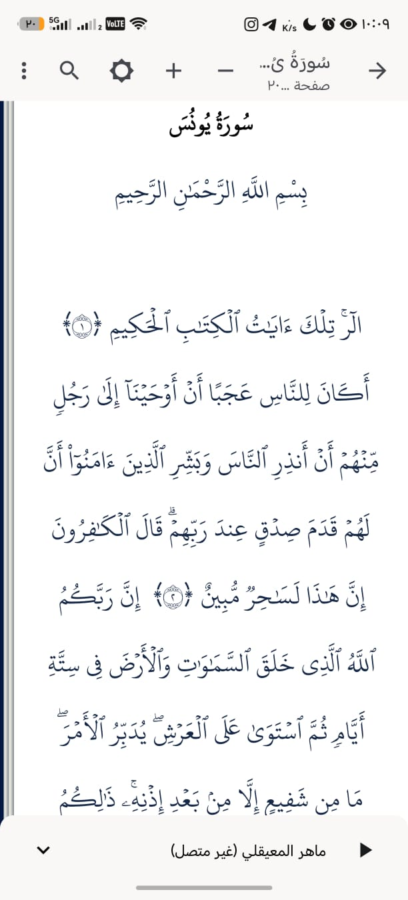
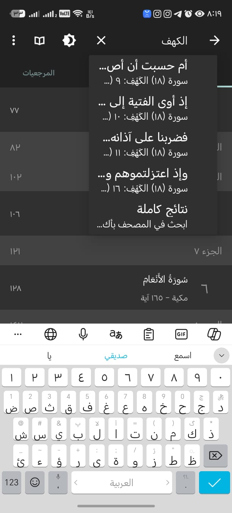
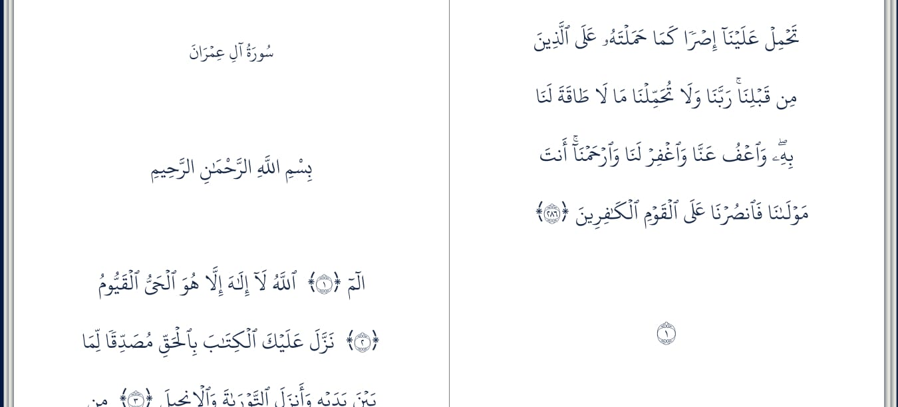

<div align="left">

<p align="center">
  
</p>

<p align="center">
  <a href="https://github.com/mohammedjaferalshouha/quran-kareem-android/releases/latest">Download latest release</a>
  ·
  <a href="README.md">العربية</a>
  ·
  <a href="docs/SETTINGS_EN.md">Settings guide</a>
  ·
  <a href="SOURCES.md">Sources and licensing</a>
</p>

# Quran Kareem

An open-source Android Quran reader focused on a clear Arabic experience and flexible Uthmani text rendering. It includes recitation, search, bookmarks, automatic reading-position recovery, light and dark themes, and a side-by-side page layout.

Current release: `1.1.7`

Application ID: `com.moham.qurankareem`

## Highlights

- A line-by-line Madani 1441 Mushaf page mode while preserving flexible Quran text as an independent option.
- Consistent 604-page pagination in both page and text reading modes.
- Continuous navigation across pages and surahs, including pages shared by two surahs.
- Clear surah headings and page numbers.
- Single-page and landscape two-page reading.
- Optional Quran text and translation side by side.
- Search from both the home screen and the reading screen.
- Search by surah name or verse text, with precise navigation to the matched location.
- Automatic last-reading-position tracking and a Continue Reading shortcut.
- Page and ayah bookmarks with categories.
- Long-press ayah actions for recitation, sharing, bookmarking, and tafsir.
- Selected-ayah tafsir from the configured tafsir source.
- An ayah action toolbar constrained to the visible screen.
- Reciter selection, playback, and downloadable audio.
- Zoom controls for text and Mushaf pages, including panning and edge handoff while zoomed.
- Fast vertical paging with queued gestures and controls kept hidden during a page drag.
- Light and dark modes accessible from the home and reading screens.
- Current reading information: surah, ayah, page, juz, hizb, and quarter.
- Orientation, night brightness, translation font size, and volume-key navigation settings.
- Arabic right-to-left interface, no ads, and no mandatory account.

## Screenshots

<p align="center">
  
  
  
</p>

<p align="center">
  
</p>

> Screenshots were captured across development builds. Minor control placement may differ from the newest release.

## Download and install

1. Open the Releases page.
2. Download the APK from the latest release.
3. Compare its SHA-256 checksum with the value published in the release notes.
4. Allow installation from the download source if Android asks.
5. Install the APK.

Releases:

`https://github.com/mohammedjaferalshouha/quran-kareem-android/releases`

## Privacy

- No advertising.
- No account is required for reading and bookmarks.
- Bookmarks, last reading position, and preferences are stored locally.
- Internet access is used when downloading recitations, translations, or other optional data.
- This distribution disables external analytics and crash reporting.

See [Privacy](PRIVACY.md).

## Build from source

Requirements:

- A current Android Studio installation
- JDK 21
- Android SDK

Windows debug build:

```powershell
.\gradlew.bat assembleMadaniDebug
```

Signed release build:

```powershell
.\gradlew.bat assembleMadaniRelease -PSTORE_FILE="PATH_TO_KEYSTORE" -PSTORE_PASSWORD="STORE_PASSWORD" -PKEY_ALIAS="KEY_ALIAS" -PKEY_PASSWORD="KEY_PASSWORD"
```

See [Build guide](docs/BUILD_EN.md).

## Sources and licensing

This modified distribution is based on:

`Quran for Android`

Upstream repository:

`https://github.com/quran/quran_android`

The application source code is distributed under:

`GNU GPL-3.0`

Quran text, translations, tafsir, fonts, recitations, and related data have separate origins and rights. The application code license does not automatically apply to every bundled or downloadable asset. Review the source list and the providers' current terms before redistribution or commercial use.

See [Sources and licensing](SOURCES.md).

## Contributing

Bug reports, improvement proposals, and GPL-compatible contributions are welcome.

See [Contributing](CONTRIBUTING.md).

## Warranty

This program is provided without warranty. When reporting a Quran text, pagination, or surah-position issue, include the surah, ayah, page number, and device model.

</div>
