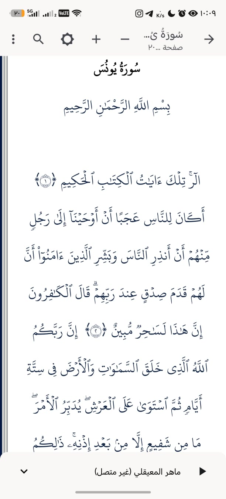
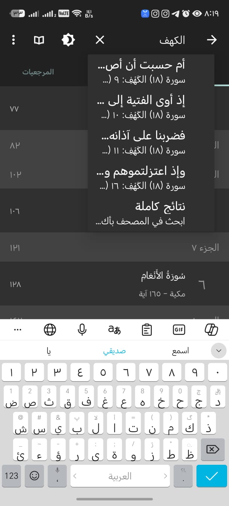
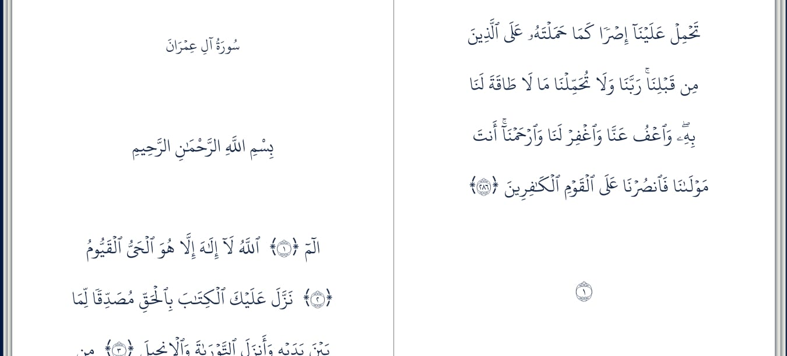

<div dir="rtl" align="right">

<p align="center">
  
</p>

<p align="center">
  <a href="https://github.com/mohammedjaferalshouha/quran-kareem-android/releases/latest">تنزيل أحدث إصدار</a>
  ·
  <a href="README.en.md">English</a>
  ·
  <a href="docs/SETTINGS_AR.md">دليل الإعدادات</a>
  ·
  <a href="SOURCES.md">المصادر والتراخيص</a>
</p>

# القرآن الكريم

تطبيق أندرويد مفتوح المصدر لقراءة القرآن الكريم بالرسم العثماني، صُمّم بواجهة عربية واضحة وتجربة قراءة مرنة، مع التلاوة الصوتية، البحث، المرجعيات، الاستمرار التلقائي من آخر موضع، الوضع الليلي، وعرض صفحتين متجاورتين.

الإصدار الحالي:

`1.1.7`

معرّف التطبيق:

`com.moham.qurankareem`

## أبرز المميزات

- وضع صفحات مصحف المدينة لعام ١٤٤١ سطرًا بسطر، مع إبقاء وضع النص القرآني المرن خيارًا مستقلًا.
- ترقيم موحّد من الصفحة الأولى حتى الصفحة رقم ٦٠٤ في وضعي الصفحات والنص.
- الانتقال المتتابع بين الصفحات والسور، بما في ذلك الصفحات المشتركة بين سورتين.
- اسم السورة ورقم الصفحة بتنسيق واضح داخل كل صفحة.
- عرض صفحة واحدة أو صفحتين متجاورتين في الوضع الأفقي.
- خيار عرض النص القرآني والترجمة جنبًا إلى جنب.
- بحث سريع من الشاشة الرئيسية ومن داخل السورة.
- البحث باسم السورة أو بجزء من الآية، ثم الانتقال إلى موضع النتيجة بدقة.
- حفظ موضع القراءة تلقائيًا وإظهار زر «متابعة القراءة».
- مرجعيات للصفحات والآيات مع تصنيفات.
- ضغط مطوّل على الآية لإظهار إجراءات الاستماع والمشاركة والمرجعية والتفسير.
- عرض تفسير الآية المحددة من مصدر التفسير المختار.
- شريط أدوات للآية يبقى داخل حدود الشاشة.
- اختيار القارئ وتشغيل التلاوة وتنزيلها للاستماع دون اتصال.
- تكبير وتصغير النص وصفحات المصحف، مع تمرير المحتوى المكبّر وتسليم الحركة إلى الصفحة التالية عند الحافة.
- تنقل رأسي سريع مع حفظ الحركات المتتابعة ومنع ظهور أدوات القراءة أثناء السحب.
- وضع فاتح ووضع مظلم مع اختصار سريع في الشاشة الرئيسية وداخل السورة.
- إظهار معلومات موضع القراءة: السورة، الآية، الصفحة، الجزء، الحزب وربع الحزب.
- إعدادات للاتجاه، سطوع النص والخلفية، حجم خط الترجمة، ومفاتيح مستوى الصوت.
- واجهة عربية من اليمين إلى اليسار، دون إعلانات أو حساب إلزامي.

## صور التطبيق

<p align="center">
  
  
  
</p>

<p align="center">
  
</p>

> الصور مأخوذة من نسخ التطوير المتعاقبة، وقد يختلف ترتيب بعض الأزرار قليلًا عن أحدث إصدار.

## التنزيل والتثبيت

1. افتح صفحة الإصدارات.
2. نزّل ملف التطبيق من أحدث إصدار.
3. تحقّق من بصمة الملف المنشورة ضمن الإصدار.
4. اسمح بالتثبيت من المصدر الذي استخدمته لتنزيل الملف عند طلب أندرويد ذلك.
5. ثبّت التطبيق.

صفحة الإصدارات:

`https://github.com/mohammedjaferalshouha/quran-kareem-android/releases`

## الخصوصية

- لا توجد إعلانات.
- لا يلزم إنشاء حساب لاستخدام القراءة والمرجعيات.
- تُحفظ المرجعيات وآخر موضع قراءة والإعدادات محليًا على الجهاز.
- الاتصال بالإنترنت مطلوب عند تنزيل التلاوات أو الترجمات أو بيانات إضافية.
- لا يحتوي هذا الإصدار على تحليلات استخدام أو تقارير أعطال خارجية.

التفاصيل:

[سياسة الخصوصية](PRIVACY.md)

## البناء من المصدر

المتطلبات الأساسية:

- أندرويد ستوديو حديث
- حزمة تطوير جافا رقم ٢١
- حزمة تطوير أندرويد

لبناء نسخة الاختبار على ويندوز:

```powershell
.\gradlew.bat assembleMadaniDebug
```

ولتجهيز إصدار موقّع، استخدم خصائص توقيع محلية لا تُرفع إلى المستودع:

```powershell
.\gradlew.bat assembleMadaniRelease -PSTORE_FILE="PATH_TO_KEYSTORE" -PSTORE_PASSWORD="STORE_PASSWORD" -PKEY_ALIAS="KEY_ALIAS" -PKEY_PASSWORD="KEY_PASSWORD"
```

التفاصيل الكاملة:

[دليل البناء](docs/BUILD_AR.md)

## المصادر والحقوق

هذا العمل نسخة معدّلة مبنية على مشروع:

`Quran for Android`

المستودع الأصلي:

`https://github.com/quran/quran_android`

الكود منشور وفق:

`GNU GPL-3.0`

النصوص القرآنية والترجمات والتفاسير والخطوط والتلاوات وبياناتها لها مصادر وأصحاب حقوق مستقلون، ولا يعني ترخيص كود التطبيق أن جميع الأصول لها الترخيص نفسه. راجع قائمة المصادر وحدود الاستخدام قبل إعادة التوزيع أو الاستخدام التجاري.

[المصادر والتراخيص بالتفصيل](SOURCES.md)

## المساهمة

نرحب بالإبلاغ عن الأخطاء واقتراح التحسينات وإرسال التعديلات المتوافقة مع الرخصة.

[دليل المساهمة](CONTRIBUTING.md)

## الضمان

يُقدّم البرنامج كما هو، دون ضمان. عند الإبلاغ عن خطأ متعلق بنص آية أو رقم صفحة أو موضع سورة، يُرجى ذكر السورة والآية والصفحة ونوع الجهاز.

</div>
